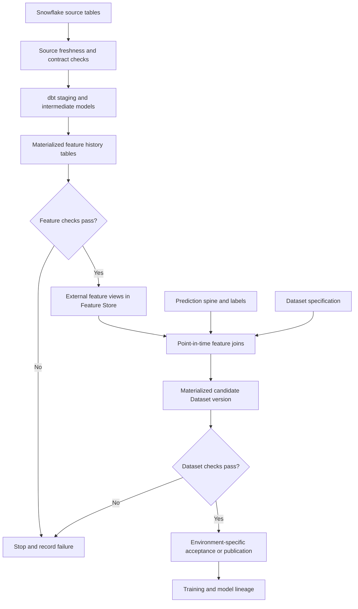
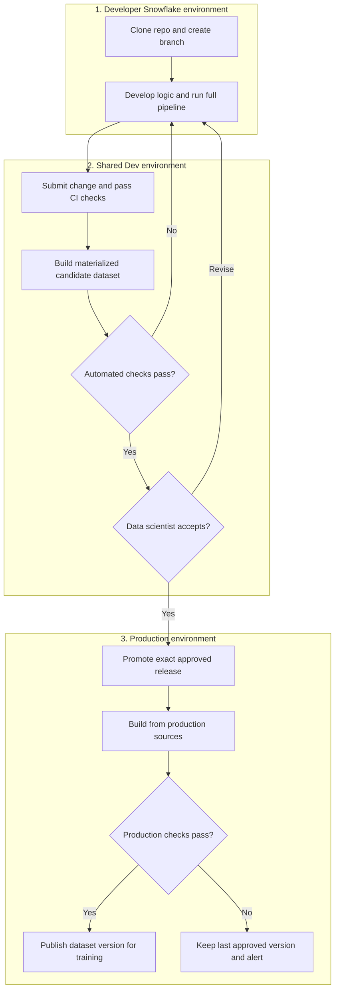
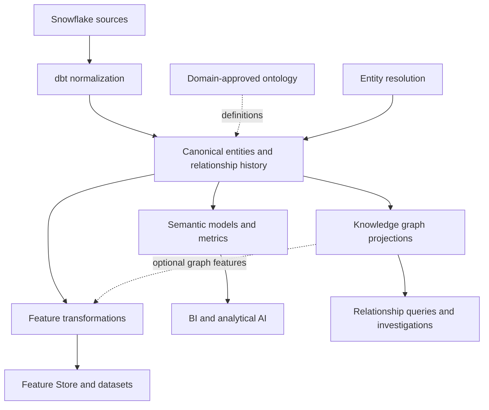
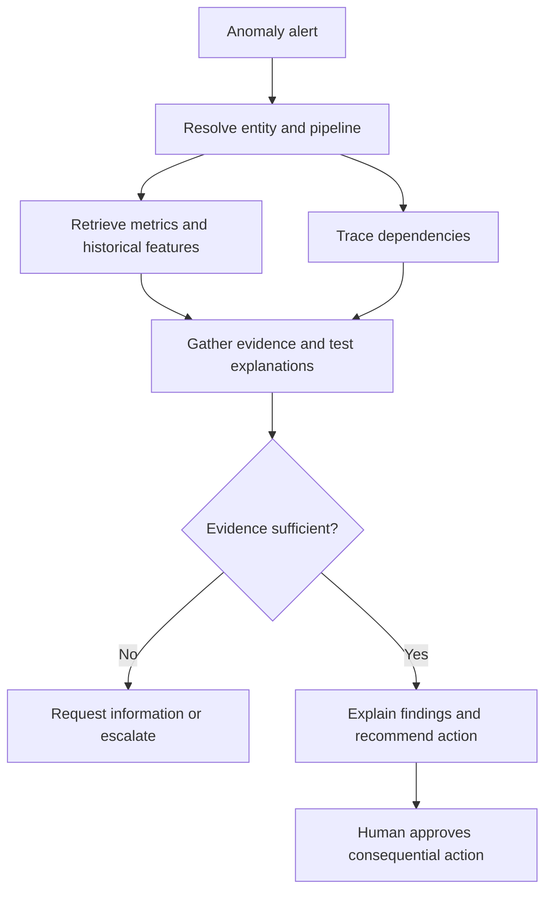

# Feature Dataset Framework and Enterprise AI Foundations

Consolidated design discussion — November 16, 2026

**Status:** Proposed architecture and operating model. No platform implementation, Snowflake resources, or adoption results are claimed here.

## 1. Objective

Build a reusable framework that lets a data scientist contribute transformation logic, generate a materialized feature dataset, validate the result in shared Dev, and promote the approved release into Production. Prefer dbt and Snowflake ML capabilities, with a small custom layer for configuration, validation, approval tracking, and publication.

The broader direction is a shared foundation for ML, analytics, and agents: consistent identities, business definitions, historical features, relationships, and governed access.

## 2. Feature dataset architecture

### Core design decisions

- A dbt model represents an **entity type or cohesive feature family**, containing many entity IDs. It is not a separate model for each individual entity.
- Each feature table has a declared grain, normally `(entity_id, feature_timestamp)`. Require both fields to be non-null and their combination to be unique.
- Intermediate transformations may be views, ephemeral models, or materialized tables. Final feature models are materialized; use incremental processing where its semantics are established.
- dbt owns transformations and refreshes. Register the resulting Snowflake tables as **external feature views**, using `refresh_freq=None`, rather than duplicating the transformation pipeline in managed feature views.
- A **prediction spine** identifies the training examples: entity keys, prediction timestamp, and optional labels. Add an example ID if multiple examples can share the same key and timestamp.
- A **dataset specification** selects feature-view versions, columns, cohort, time range, labels, missing-value policy, maximum feature age, and split policy.
- Use `FeatureStore.generate_dataset()` for a materialized, immutable Snowflake Dataset version. Pin that version for reproducible training.
- A feature-view definition version does not freeze its mutable backing table. Preserve backing-table semantics across definition versions and fix input state during dataset assembly.

### Incremental and historical correctness

Incremental feature tables and immutable training datasets serve different purposes. Merge new or affected feature rows using the declared composite key. Detect changes using ingestion/update metadata or a governed change feed; recompute affected windows with sufficient historical context.

Define late-arrival, correction, deletion, and backfill policies explicitly. Test idempotent reruns and equivalence between a full build and incremental replay over identical inputs. Advance successful publication watermarks only after the relevant gates pass.

Keep event time, availability time, and execution time distinct. A historical feature must contain only information eligible at prediction time. A point-in-time join cannot fix future information already embedded in the transformation. Relationship history and changing dimensions need the same treatment.

When feature logic changes, create a new definition version and backfill its required history. For very large training sets, optionally maintain a working training table incrementally and create an immutable Dataset snapshot at release time. This working-table maintenance is custom logic, not an automatic append capability of an immutable Dataset version.

## 3. Three environments and promotion

| Environment | Purpose | Output and exit condition |
| --- | --- | --- |
| Developer's Snowflake sandbox | Clone the repo, implement transformations and tests, and run the full pipeline privately | Experimental dataset; ready for submission after developer checks |
| Shared Dev | Run the submitted code through the managed pipeline on representative governed inputs | Materialized candidate dataset and validation report; automated gates and scientist acceptance required |
| Production | Run the approved code/configuration against production sources | Publish a production dataset version only after production validation |

CI/CD connects these environments; it is not a fourth release tier. Temporary resources used by CI belong to the testing workflow. Separate databases/schemas and roles can implement the isolation; three separate Snowflake accounts are not inherently required.

Use candidate namespaces per PR/release in shared Dev. Record acceptance against the exact code/artifact digest, specification versions, candidate dataset version, input cutoff, validation report, approver, and timestamp. Material changes require a new reviewed candidate.

Production promotes the accepted definitions and recomputes against production inputs. Consumers resolve a framework-owned approved-version reference, rather than treating the newest created dataset as approved. Routine refreshes of an already accepted definition can run automatically with production checks; new definitions return through shared Dev acceptance.

### Required validation

| Gate | Evidence |
| --- | --- |
| Source readiness | Freshness, completeness, schema and volume expectations |
| Contracts and keys | Valid types, required columns, non-null keys and compound uniqueness |
| Transformation logic | Unit fixtures for windows, nulls, duplicates, boundaries and changing dimensions |
| Incremental correctness | Full-build parity, late data, corrections, delete policy and idempotent retries |
| Temporal correctness | No future information, label leakage or excessively stale features |
| Dataset integrity | Preserved spine grain, no join multiplication, acceptable coverage and valid splits |
| Operational readiness | Runtime/cost budgets, permissions, consistent inputs and usable failure reports |
| Scientist acceptance | Review sample entities, reconcile values, examine distributions, optionally smoke-test training |

Use dbt Projects on Snowflake and Snowflake Tasks where supported, with Snowpark/Python for registration and dataset operations. Pin compatible runtime versions. Run source freshness explicitly rather than assuming it is part of `dbt build`.

## 4. Broader platform: entities, ontology, semantics and graphs

The proposed team charter is **Data and AI Foundations**. The team owns reusable engineering capabilities and can implement the first domain end to end. Domain teams remain accountable for business meaning and approve their definitions.

| Capability | Meaning | Platform team owns | Domain teams own |
| --- | --- | --- | --- |
| Entity foundation | Canonical identities and mappings | Identifier conventions, resolution tools, historical mappings and contracts | Authoritative identifiers and matching-rule acceptance |
| Ontology | Concepts, relationship types and constraints | Versioning, validation, authoring format and deployment | Concept definitions and relationship meaning |
| Semantic layer | Metrics, dimensions and valid analytical joins | Runtime, integrations, tests and release process | Formulas, interpretation and approval |
| Knowledge graph | Actual entities and relationships | Construction, provenance, query interfaces and operations | Relationship rules and factual acceptance |
| Feature framework | Historical signals for training/inference | Materialization, temporal checks and publishing | Feature logic, labels and dataset acceptance |

Prefer Snowflake Semantic Views when Snowflake/Cortex are the main consumers; consider dbt Semantic Layer when the organization already standardizes on its interfaces. Choose an authoritative definition source and controlled synchronization if both are used. dbt transformation models alone do not imply deployment of the hosted dbt Semantic Layer.

Start the ontology with practical definitions and constraints. Begin graph storage with governed entity and edge tables; introduce a specialized graph engine when demonstrated traversal, latency or reasoning requirements justify it. A graph is not a prerequisite for the feature framework.

A useful initial use case is AIOps dependency analysis: identify which feeds, datasets, features and models depend on a failing ingestion pipeline. This is primarily a lineage/dependency graph. Keep its technical edges distinct from business relationships. Dependency supports investigation and impact analysis; it does not by itself establish causation.

## 5. Support for agents

Agents can use the foundation to interpret business concepts, query approved metrics, retrieve historical signals, explore dependencies, and return evidence-grounded explanations.

Add a governed tool layer with proposed interfaces such as:

- `resolve_entity(...)`
- `query_metric(...)`
- `get_features_as_of(...)`
- `trace_dependencies(...)`
- `get_supporting_evidence(...)`

These are interfaces to implement, not existing framework APIs. Enforce caller permissions and return provenance, timestamps, version identifiers and explicit missing-data indicators. Separate read-only investigation from consequential actions requiring approval. Treat retrieved text as evidence rather than executable instructions, and evaluate tool behavior and failure handling before production.

Example question: “Is this dealer's transmission-volume drop unusual, caused by a source issue, or associated with a shared ingestion failure, and what downstream assets are affected?”

Operational tools query appropriately fresh governed data. Immutable datasets support reproducible model training and agent evaluation. The foundation team owns data/tool reliability; application teams own agent workflows and their outcome evaluations.

## 6. Implementation sequence

1. **Feature framework MVP:** one entity family, one dataset, the three environments, automated tests, scientist acceptance and production publishing.
2. **Shared entity foundation:** canonical IDs, entity resolution, historical mappings and reusable contracts.
3. **One domain's semantics:** a small ontology and approved metrics with accountable owners.
4. **Focused AIOps graph:** dependency/impact queries and evidence provenance.
5. **Agent pilot:** read-only investigation tools, representative evaluation cases, escalation and controlled actions.

Measure dataset delivery time, feature reuse, adoption across teams, defect/leakage detection, refresh reliability and cost. For agents, measure evidence accuracy, tool correctness, permission compliance, appropriate escalation and investigation time. Establish baselines before claiming improvement.

### Proposed repository areas

| Area | Contents |
| --- | --- |
| `models/` | dbt staging, intermediate, feature and spine models |
| `tests/` | Data and integration checks; keep dbt unit-test YAML alongside its models |
| `feature_specs/`, `dataset_specs/` | Contracts, definitions, selections and versions |
| `ontology/`, `semantics/`, `graph/` | Domain definitions, approved metrics and graph mappings |
| `framework/` | Registration, dataset building, validation and release metadata |
| `agent_tools/` | Governed query interfaces and tool evaluations |
| `environments/` | Sandbox, shared Dev and Production settings |
| `docs/` | Architecture, contribution workflow and ownership |

## 7. Personal profile alignment discussed

This work is consistent with the professional theme of **applied enterprise AI, trustworthy data foundations, anomaly detection and automated assurance**. It extends existing work in audit automation, document intelligence, monitoring, entity resolution and agent-assisted investigations.

For an EB-1A profile narrative, the relevant future evidence would be individually attributable design/leadership, documented adoption, measurable outcomes and recognition. Merely adding technologies or joining a platform team does not establish that impact. These are planning observations, not a legal eligibility determination or a claim of achievements already completed. Field framing and evidentiary use should be reviewed with immigration counsel.

## 8. Primary technical references

- [Snowflake feature views](https://docs.snowflake.com/en/developer-guide/snowflake-ml/feature-store/feature-views)
- [Feature Store training data and datasets](https://docs.snowflake.com/en/developer-guide/snowflake-ml/feature-store/modeling)
- [Snowflake Datasets](https://docs.snowflake.com/en/developer-guide/snowflake-ml/dataset)
- [dbt incremental models](https://docs.getdbt.com/docs/build/incremental-models)
- [dbt source freshness](https://docs.getdbt.com/docs/deploy/source-freshness)
- [Snowflake dbt CI/CD with per-PR databases](https://docs.snowflake.com/en/user-guide/tutorials/dbt-projects-on-snowflake-advanced-ci-cd-tutorial)
- [Snowflake dbt scheduling](https://docs.snowflake.com/en/user-guide/data-engineering/dbt-projects-on-snowflake-schedule-project-execution)
- [Snowflake Semantic Views](https://docs.snowflake.com/en/user-guide/views-semantic/overview)
- [dbt Semantic Layer architecture](https://docs.getdbt.com/docs/use-dbt-semantic-layer/sl-architecture)

Technical references were consulted during the design discussion. Validate supported versions, privileges, product availability and licensing during implementation.
